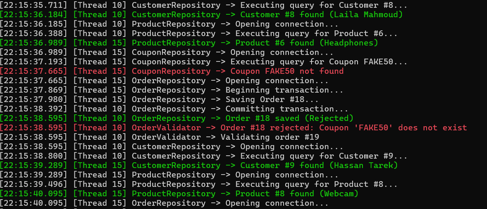
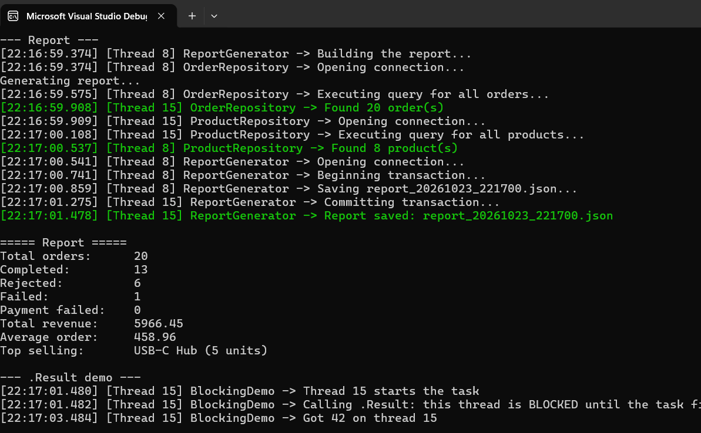
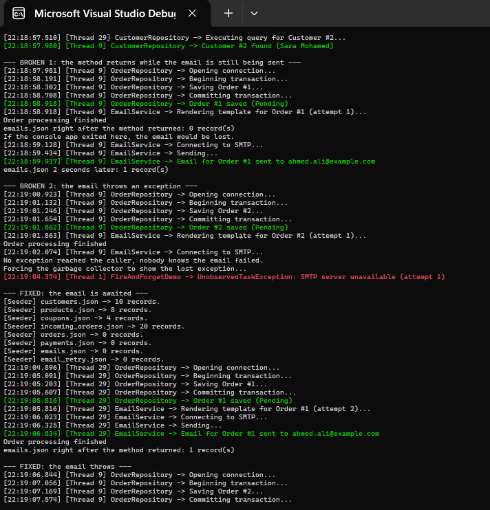
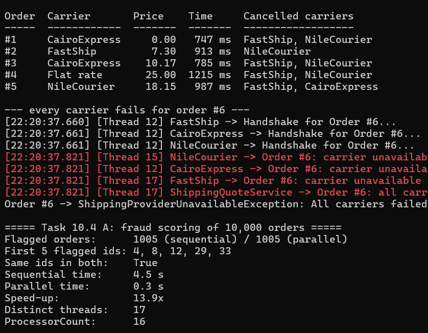
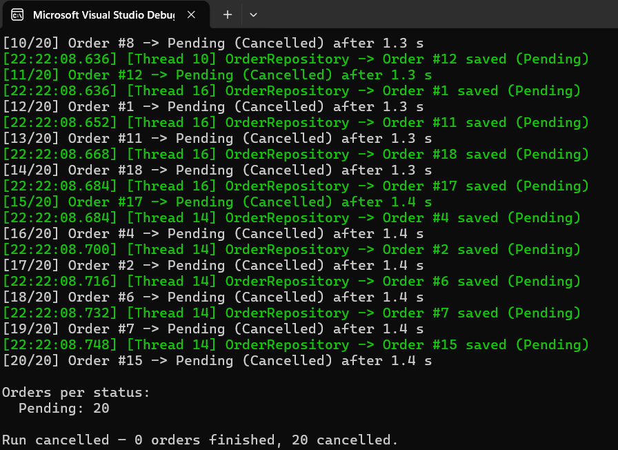

# JoPlusPlus-Threads-Assignment
Assignment repo for assignment/1-8 (Threads Assignment)

# 1. How to run each phase and where the Data folder is created; project structure and the role of each class.
- Once you run the project you will get a Menu to choose from


```
E:.
│   .gitignore
│   image.png
│   README.md
│
├───01-InvoiceExport
│   │   .gitignore
│   │   ANSWERS.md
│   │   InvoiceExport.slnx
│   │   README.md
│   │
│   └───InvoiceExport
│       │   CustomerFileStore.cs
│       │   InvoiceExport.csproj
│       │   InvoiceExportService.cs
│       │   InvoiceFileWriter.cs
│       │   Models.cs
│       │   OrderDatabase.cs
│       │   Program.cs
│       │
│       ├───bin
│       │   └───Debug
│       │       └───net9.0
│       └───obj
│           │   InvoiceExport.csproj.nuget.dgspec.json
│           │   InvoiceExport.csproj.nuget.g.props
│           │   InvoiceExport.csproj.nuget.g.targets
│           │   project.assets.json
│           │   project.nuget.cache
│           │
│           └───Debug
│               └───net9.0
│                   │   .NETCoreApp,Version=v9.0.AssemblyAttributes.cs
│                   │   InvoiceExport.AssemblyInfo.cs
│                   │   InvoiceExport.AssemblyInfoInputs.cache
│                   │   InvoiceExport.assets.cache
│                   │   InvoiceExport.GeneratedMSBuildEditorConfig.editorconfig
│                   │   InvoiceExport.GlobalUsings.g.cs
│                   │
│                   ├───ref
│                   └───refint
├───02-TableBooking
│   │   .gitignore
│   │   ANSWERS.md
│   │   README.md
│   │   TableBooking.slnx
│   │
│   └───TableBooking
│       │   FridayNightBooking.cs
│       │   Program.cs
│       │   TableBooking.csproj
│       │
│       ├───bin
│       │   └───Debug
│       │       └───net9.0
│       │               TableBooking.deps.json
│       │               TableBooking.dll
│       │               TableBooking.exe
│       │               TableBooking.pdb
│       │               TableBooking.runtimeconfig.json
│       │
│       └───obj
│           │   project.assets.json
│           │   project.nuget.cache
│           │   TableBooking.csproj.nuget.dgspec.json
│           │   TableBooking.csproj.nuget.g.props
│           │   TableBooking.csproj.nuget.g.targets
│           │
│           └───Debug
│               └───net9.0
│                   │   .NETCoreApp,Version=v9.0.AssemblyAttributes.cs
│                   │   apphost.exe
│                   │   TableBooking.AssemblyInfo.cs
│                   │   TableBooking.AssemblyInfoInputs.cache
│                   │   TableBooking.assets.cache
│                   │   TableBooking.csproj.BuildWithSkipAnalyzers
│                   │   TableBooking.csproj.CoreCompileInputs.cache
│                   │   TableBooking.csproj.FileListAbsolute.txt
│                   │   TableBooking.dll
│                   │   TableBooking.GeneratedMSBuildEditorConfig.editorconfig
│                   │   TableBooking.genruntimeconfig.cache
│                   │   TableBooking.GlobalUsings.g.cs
│                   │   TableBooking.pdb
│                   │   TableBooking.sourcelink.json
│                   │
│                   ├───ref
│                   │       TableBooking.dll
│                   │
│                   └───refint
│                           TableBooking.dll
│
├───03-LockingResearch
│       .gitignore
│       ANSWERS.md
│       README.md
│
├───04-MenuViews
│   │   .gitignore
│   │   ANSWERS.md
│   │   MenuViews.slnx
│   │   README.md
│   │
│   └───MenuViews
│       │   MenuViewCounter.cs
│       │   MenuViews.csproj
│       │   Program.cs
│       │
│       ├───bin
│       │   └───Debug
│       │       └───net9.0
│       │               MenuViews.deps.json
│       │               MenuViews.dll
│       │               MenuViews.exe
│       │               MenuViews.pdb
│       │               MenuViews.runtimeconfig.json
│       │
│       └───obj
│           │   MenuViews.csproj.nuget.dgspec.json
│           │   MenuViews.csproj.nuget.g.props
│           │   MenuViews.csproj.nuget.g.targets
│           │   project.assets.json
│           │   project.nuget.cache
│           │
│           └───Debug
│               └───net9.0
│                   │   .NETCoreApp,Version=v9.0.AssemblyAttributes.cs
│                   │   apphost.exe
│                   │   MenuViews.AssemblyInfo.cs
│                   │   MenuViews.AssemblyInfoInputs.cache
│                   │   MenuViews.assets.cache
│                   │   MenuViews.csproj.BuildWithSkipAnalyzers
│                   │   MenuViews.csproj.CoreCompileInputs.cache
│                   │   MenuViews.csproj.FileListAbsolute.txt
│                   │   MenuViews.dll
│                   │   MenuViews.GeneratedMSBuildEditorConfig.editorconfig
│                   │   MenuViews.genruntimeconfig.cache
│                   │   MenuViews.GlobalUsings.g.cs
│                   │   MenuViews.pdb
│                   │
│                   ├───ref
│                   │       MenuViews.dll
│                   │
│                   └───refint
│                           MenuViews.dll
│
├───05-ViewsAndEmails
│   │   .gitignore
│   │   ANSWERS.md
│   │   README.md
│   │   ViewsAndEmails.slnx
│   │
│   └───ViewsAndEmails
│       │   AnalyticsAndEmailJobs.cs
│       │   Program.cs
│       │   ViewsAndEmails.csproj
│       │
│       ├───bin
│       │   └───Debug
│       │       └───net9.0
│       │               ViewsAndEmails.deps.json
│       │               ViewsAndEmails.dll
│       │               ViewsAndEmails.exe
│       │               ViewsAndEmails.pdb
│       │               ViewsAndEmails.runtimeconfig.json
│       │
│       └───obj
│           │   project.assets.json
│           │   project.nuget.cache
│           │   ViewsAndEmails.csproj.nuget.dgspec.json
│           │   ViewsAndEmails.csproj.nuget.g.props
│           │   ViewsAndEmails.csproj.nuget.g.targets
│           │
│           └───Debug
│               └───net9.0
│                   │   .NETCoreApp,Version=v9.0.AssemblyAttributes.cs
│                   │   apphost.exe
│                   │   ViewsAndEmails.AssemblyInfo.cs
│                   │   ViewsAndEmails.AssemblyInfoInputs.cache
│                   │   ViewsAndEmails.assets.cache
│                   │   ViewsAndEmails.csproj.BuildWithSkipAnalyzers
│                   │   ViewsAndEmails.csproj.CoreCompileInputs.cache
│                   │   ViewsAndEmails.csproj.FileListAbsolute.txt
│                   │   ViewsAndEmails.dll
│                   │   ViewsAndEmails.GeneratedMSBuildEditorConfig.editorconfig
│                   │   ViewsAndEmails.genruntimeconfig.cache
│                   │   ViewsAndEmails.GlobalUsings.g.cs
│                   │   ViewsAndEmails.pdb
│                   │
│                   ├───ref
│                   │       ViewsAndEmails.dll
│                   │
│                   └───refint
│                           ViewsAndEmails.dll
│
├───06-OrderProcessing
│   │   .gitignore
│   │   Answers.md
│   │   Mini_Project___Order_Processing_System.csproj
│   │   Mini_Project___Order_Processing_System.slnx
│   │   Program.cs
│   │   README.md
│   │
│   ├───bin
│   │   └───Debug
│   │       └───net10.0
│   │           │   Mini_Project___Order_Processing_System.deps.json
│   │           │   Mini_Project___Order_Processing_System.dll
│   │           │   Mini_Project___Order_Processing_System.exe
│   │           │   Mini_Project___Order_Processing_System.pdb
│   │           │   Mini_Project___Order_Processing_System.runtimeconfig.json
│   │           │
│   │           └───Data
│   │               │   coupons.json
│   │               │   customers.json
│   │               │   emails.json
│   │               │   email_retry.json
│   │               │   incoming_orders.json
│   │               │   orders.json
│   │               │   payments.json
│   │               │   products.json
│   │               │
│   │               ├───invoices
│   │               └───reports
│   ├───Data
│   │       DataFiles.cs
│   │       DataSeeder.cs
│   │       JsonFileStore.cs
│   │       Log.cs
│   │       Simulate.cs
│   │
│   ├───Models
│   │       Models.cs
│   │
│   ├───MyExceptions
│   │       CustomerNotFoundException.cs
│   │       DatabaseWriteException.cs
│   │       DataFileCorruptedException.cs
│   │       InvalidCouponException.cs
│   │       ShippingProviderUnavailableException.cs
│   │       SmtpUnavailableException.cs
│   │
│   ├───obj
│   │   │   Mini_Project___Order_Processing_System.csproj.nuget.dgspec.json
│   │   │   Mini_Project___Order_Processing_System.csproj.nuget.g.props
│   │   │   Mini_Project___Order_Processing_System.csproj.nuget.g.targets
│   │   │   project.assets.json
│   │   │   project.nuget.cache
│   │   │
│   │   └───Debug
│   │       └───net10.0
│   │           │   .NETCoreApp,Version=v10.0.AssemblyAttributes.cs
│   │           │   apphost.exe
│   │           │   Mini_Pro.BCBB6025.Up2Date
│   │           │   Mini_Project___Order_Processing_System.AssemblyInfo.cs
│   │           │   Mini_Project___Order_Processing_System.AssemblyInfoInputs.cache
│   │           │   Mini_Project___Order_Processing_System.assets.cache
│   │           │   Mini_Project___Order_Processing_System.csproj.BuildWithSkipAnalyzers
│   │           │   Mini_Project___Order_Processing_System.csproj.CoreCompileInputs.cache
│   │           │   Mini_Project___Order_Processing_System.csproj.FileListAbsolute.txt
│   │           │   Mini_Project___Order_Processing_System.dll
│   │           │   Mini_Project___Order_Processing_System.GeneratedMSBuildEditorConfig.editorconfig
│   │           │   Mini_Project___Order_Processing_System.genruntimeconfig.cache
│   │           │   Mini_Project___Order_Processing_System.GlobalUsings.g.cs
│   │           │   Mini_Project___Order_Processing_System.pdb
│   │           │   Mini_Project___Order_Processing_System.sourcelink.json
│   │           │
│   │           ├───ref
│   │           │       Mini_Project___Order_Processing_System.dll
│   │           │
│   │           └───refint
│   │                   Mini_Project___Order_Processing_System.dll
│   │
│   ├───Repositories
│   │       CouponRepository.cs
│   │       CustomerRepository.cs
│   │       IncomingOrderRepository.cs
│   │       OrderRepository.cs
│   │       ProductRepository.cs
│   │       SyncCouponRepository.cs
│   │       SyncCustomerRepository.cs
│   │       SyncOrderRepository.cs
│   │       SyncOrderValidator.cs
│   │       SyncProductRepository.cs
│   │
│   ├───Runners
│   │       BlockingDemo.cs
│   │       FireAndForgetDemo.cs
│   │       Phase1Runner.cs
│   │       Phase2Runner.cs
│   │       Phase3Runner.cs
│   │       Phase4Runner.cs
│   │       RaceConditionDemo.cs
│   │
│   └───Services
│           CairoExpress.cs
│           CustomerDashboardService.cs
│           CustomerService.cs
│           EmailResendService.cs
│           EmailService.cs
│           FastShip.cs
│           FraudScoringService.cs
│           IEmailService.cs
│           InventoryService.cs
│           InvoiceGenerator.cs
│           IPaymentGateway.cs
│           IShippingCarrier.cs
│           NileCourier.cs
│           OrderPricer.cs
│           OrderProcessor.cs
│           OrderProcessorV2.cs
│           OrderValidator.cs
│           PaymentGateway.cs
│           PricingService.cs
│           ReportGenerator.cs
│           ShippingCarrierBase.cs
│           ShippingPrice.cs
│           ShippingQuoteService.cs
│           SyncCustomerService.cs
│           SyncEmailService.cs
│           SyncInventoryService.cs
│           SyncOrderProcessor.cs
│           SyncPaymentGateway.cs
│           SyncPricingService.cs
│
└───LinkedIn
```

# 2. Storage design: the file list, the JSON format, and how you kept the files  correct under concurrent access.
- ### The design is shown above
- ### i used Locks to to handle multi access

# 3. A performance table: Phase 1 sync vs async; Phase 2 pricing sequential vs concurrent; Phase 2 concurrent processing; Phase 3 sync (10 threads) vs async (10 tasks); Phase 4 dashboard, shipping quotes, fraud scoring (sequential vs parallel) and email re-send — time, distinct threads, ThreadPool.ThreadCount.

- ### Sorry

# 4. Console screenshots of each phase: race demo, faulted task, payment timeout, refund, email retry, both fire-and-forget demos, every Phase 4 task, and one cancelled run.

## Phase 1


## Phase 2


## Phase 3


## Phase 4


## Cancelled Run


## 5. The problems you found while building it and how you solved each one
i already logged that in the Answers.md for each phase

## 6. Answers to every question in Phases 1–4.
Done in Answers.md
